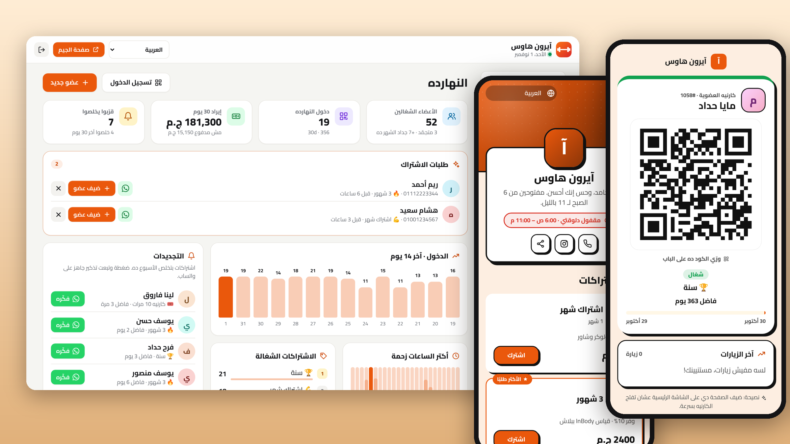
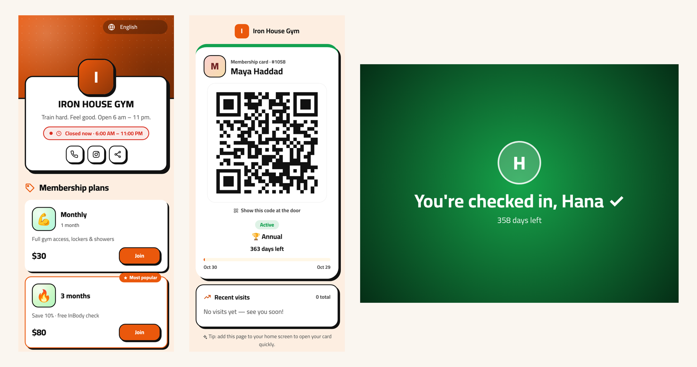

# نادي · Nadi

**نظام اشتراكات للجيمات والستوديوهات وأندية البوكس والأكاديميات الرياضية، على السيرفر بتاعك.**
الأعضاء، والاشتراكات، وتسجيل الدخول بالـ QR على الباب، والتجميد، والفلوس، وتذكير التجديد على واتساب. من غير اشتراك شهري، و8 لغات.

[English](README.md) · [العربية](README.ar.md)

---

## ليه نادي؟

أغلب الجيمات الصغيرة وستوديوهات اليوجا وأندية البوكس وأكاديميات الكورة شغالة بكشكول أو شيت Excel أو برنامج ويندوز قديم في الريسبشن. محدش عارف مين اشتراكه خلص، وفيه ناس بتدخل باشتراكات قديمة، والتجديد بيتطارد باليد. برامج الجيمات بتحل ده بـ **50 لـ 200 دولار في الشهر**، وغالبًا من غير عربي ولا واتساب.

نادي شغال على السيرفر بتاعك وبالدومين بتاعك:

1. **انشره** بضغطة واحدة (والـ HTTPS جاهز).
2. **اختار النوع**: جيم، أو ستوديو يوجا وبيلاتس، أو بوكس وفنون قتالية، أو أكاديمية رياضية، وابدأ باشتراكات وجدول حصص جاهزين.
3. **ضيف الأعضاء وبيع الاشتراكات.** كل عضو بياخد **لينك كارنيه فيه QR**. بيورّيه على الباب، أو يمسحه على تابلت بيسجّل دخوله لوحده.
4. **جدّد بضغطة.** نادي بيقولك مين اشتراكه بيخلص الأسبوع ده ومين خلص، ويفتحلك واتساب برسالة تذكير جاهزة.

## المميزات

**على الباب**
- 📱 **كارنيه ديجيتال** لكل عضو: QR، والاشتراك، والأيام أو المرات الفاضلة، وآخر الزيارات. مفيش أبلكيشن يتنزل، ده لينك بيوصله على واتساب.
- 🚪 **تابلت تسجيل دخول ذاتي**: افتح لينك سري على أي تابلت أو موبايل قديم عند المدخل. العضو يقرّب الكارنيه، ويشوف شاشة خضرا كبيرة **أهلًا يا عمر!** أو حمرا **اشتراكك خلص**، مع صوت.
- 🎯 **تسجيل من الريسبشن**: بكاميرا اللابتوب أو الموبايل، أو بالبحث بالاسم أو الرقم أو رقم العضوية. لو حد مسح مرتين في نص ساعة مش بتتحسب مرتين، وأي تسجيل ينفع يتلغي.
- 📷 شغال على الآيفون والأندرويد والكمبيوتر.

**الاشتراكات**
- 🏷️ **اشتراكات** بالشهور أو الأيام، أو **كارنيه مرات** (مثلًا 12 تمرينة في شهرين)
- 🔁 **التجديد بدري** بيبدأ بعد الاشتراك الحالي على طول، فمحدش بيخسر أيام
- ⏸️ **تجميد** للسفر أو الإصابة: تاريخ النهاية بيتأخر، ولو فك التجميد بدري الأيام اللي ما استخدمهاش بترجع
- 💰 **المدفوعات** كاش أو كارت أو تحويل أو محفظة، مع **دفع جزئي** وحساب الباقي على كل عضو
- ⏳ **فترة سماح** اختيارية: العضو يدخل كام يوم بعد ما الاشتراك يخلص، مع تنبيه
- 👤 ملف لكل عضو فيه صورة، وملاحظات (إصابات، أهداف)، وسجل الزيارات والمدفوعات والاشتراكات

**تكبير الجيم**
- 🔔 **التجديدات**: الاشتراكات اللي بتخلص الأسبوع ده، ولكل واحد زرار تذكير على واتساب
- 💔 **رجّعهم تاني**: اللي اشتراكهم خلص الشهر ده وما جددوش
- 📊 **لوحة النهارده**: الأعضاء الشغالين، والدخول، وإيراد 30 يوم ومقارنته بالفترة اللي قبلها، والفلوس اللي لسه ما اندفعتش، ورسم الدخول لآخر 14 يوم، و**أكتر الساعات زحمة**
- 🌐 **صفحة للجيم**: الاشتراكات بأسعارها، و**جدول الحصص**، ومواعيد العمل، وزرار **اشترك**. طلبات الاشتراك بتوصلك في اللوحة وعلى واتساب وتيليجرام.
- 📄 **تصدير Excel** للأعضاء والمدفوعات، ونسخة احتياطية كاملة واسترجاعها
- 🎨 4 ثيمات، و5 خطوط عربي، وأي لون، ولوجو وغلاف، مع معاينة حية على شكل موبايل
- 🌍 **8 لغات**، والعربي بالكامل من اليمين للشمال

**للسيرفر**
- **3 مكتبات صغيرة** بس، ومفيش داتابيز محتاجة إعداد، وبيشتغل على أصغر VPS
- **HTTPS أوتوماتيك** عن طريق Caddy، و**كود إعداد** بيحمي التثبيت الجديد، و**وضع ديمو**

## النشر

### الطريقة 1: ضغطة واحدة على Hostinger VPS (الأفضل)

1. دوس **Deploy on Hostinger** فوق.
2. **عشان الـ HTTPS:** وجّه سجل الـ A بتاع الدومين للسيرفر، وحط `DOMAIN=gym.example.com`. الـ HTTPS مهم كمان عشان الكاميرا تشتغل في تسجيل الدخول.
3. **كود الإعداد:** افتح الـ logs بتاعة الـ container اللي اسمه `nadi` وانسخ `Setup code`، أو حط الكود بتاعك في `SETUP_CODE`.
4. افتح الدومين، وروح على `/admin`، واكتب الكود.

### الطريقة 2: Node.js web app على هوستنجر

hPanel ← **Websites ← Add website ← Node.js app ← Import Git repository**، والملف الرئيسي `server.js`، وحط `DATA_DIR` في فولدر **برّه** فولدر التطبيق.

## شاشة الباب

1. من اللوحة افتح **تسجيل الدخول** (أو **المشاركة**) وانسخ **لينك الباب**. اللينك فيه كود سري، فاتعامل معاه كأنه مفتاح.
2. افتحه على تابلت أو موبايل قديم عند المدخل واسمح للكاميرا. الشاشة بتفضل منوّرة.
3. العضو يفتح لينك الكارنيه (بيوصله على واتساب لما يشترك) ويقرّب الـ QR من الكاميرا.

شاشة الباب بتقبل QR الكارنيه بس، مش رقم العضوية، ومش بتعرض غير الاسم الأول والحالة. ولو التابلت ضاع، دوس **غيّر لينك الباب** واللينك القديم هيبطّل.

## وضع الوكالة: كل عملاءك على سيرفر واحد

لو إنت فريلانسر أو وكالة، تقدر تشغّل **سيرفر نادي واحد لجيمات كتير**. كل جيم بياخد نسخة مستقلة تمامًا على `client.yourdomain.com` أو على الدومين بتاعه، وبـ HTTPS أوتوماتيك. وإنت بتدير الكل من لوحة واحدة على `/hub`: تعمل عميل في ثواني، وتبعتله لينك الإعداد على واتساب، وتتابع الاشتراكات ومين متأخر، وتوقف اللي ما دفعش.

1. وجّه سجلين DNS للسيرفر: `apps.example.com` و`*.apps.example.com`.
2. شغّل [`examples/agency/docker-compose.yml`](examples/agency) بـ `BASE_DOMAIN=apps.example.com`.
3. افتح `https://apps.example.com/hub` واكتب كود الإعداد اللي في اللوج.

## إشعارات تيليجرام

من **الإعدادات ← إشعارات فورية (تيليجرام)** حط توكن البوت من [‎@BotFather](https://t.me/BotFather)، ودوس **لاقي المحادثة** وبعدين **ابعت تجربة**. هيوصلك إشعار مع كل طلب اشتراك من صفحة الجيم.

## الترخيص

[MIT](LICENSE)

