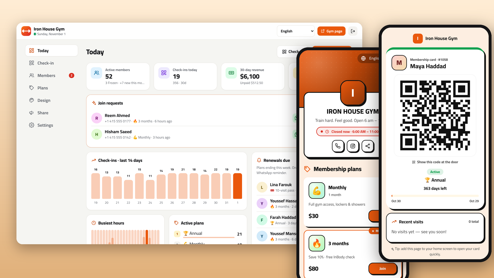
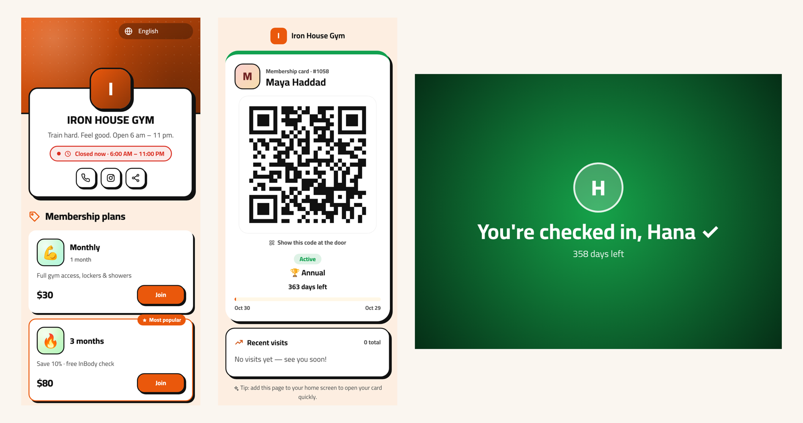
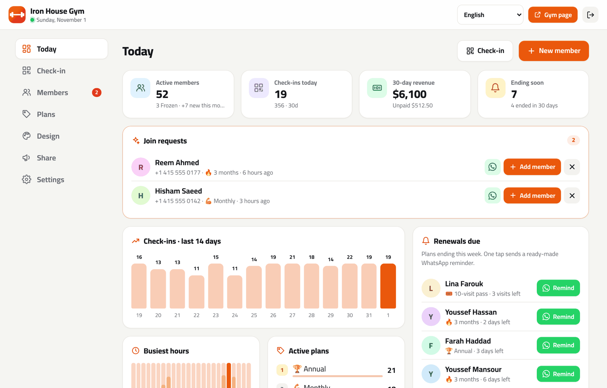
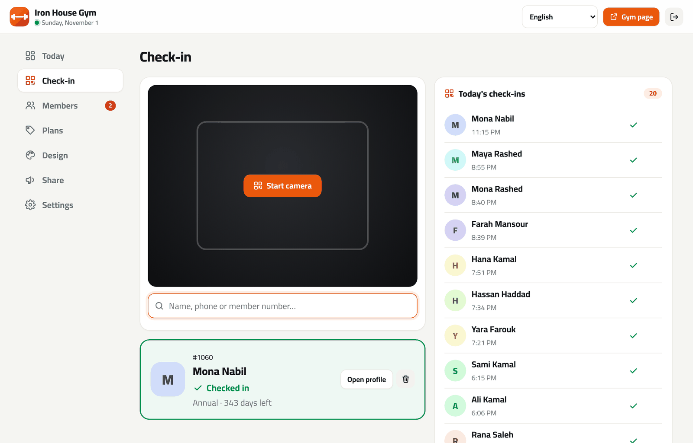
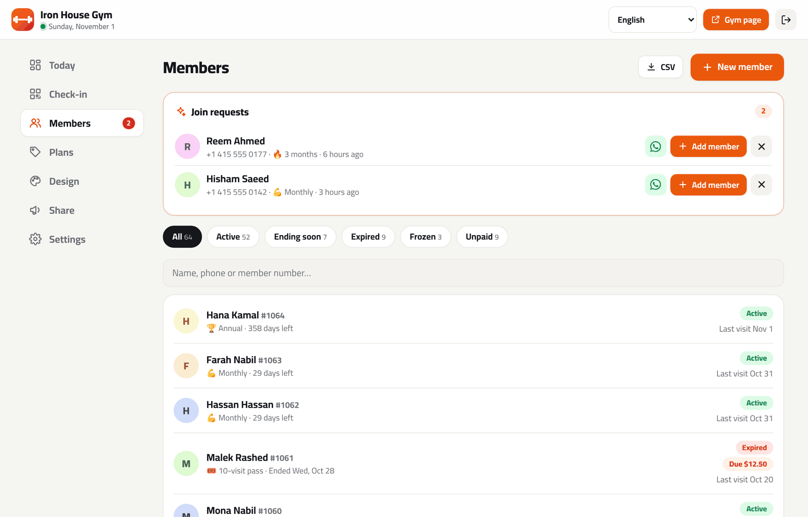
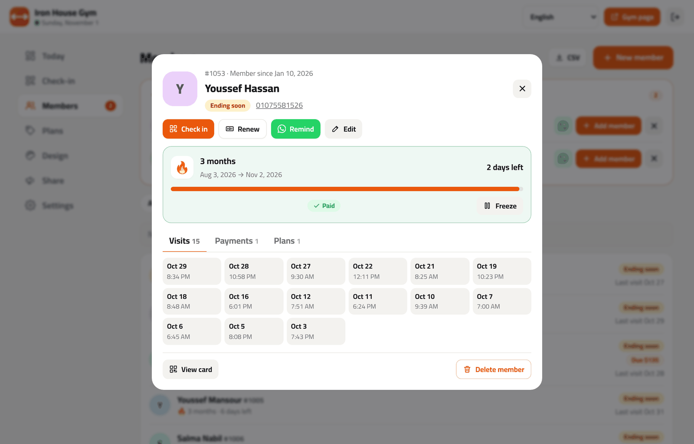
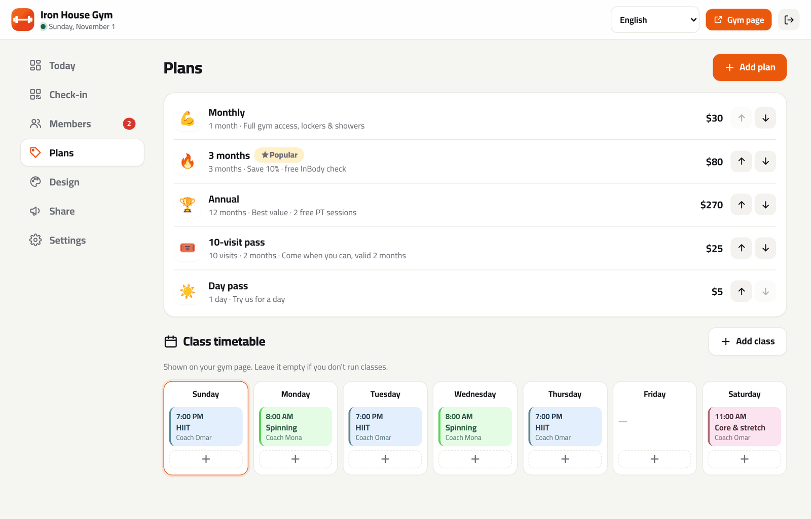
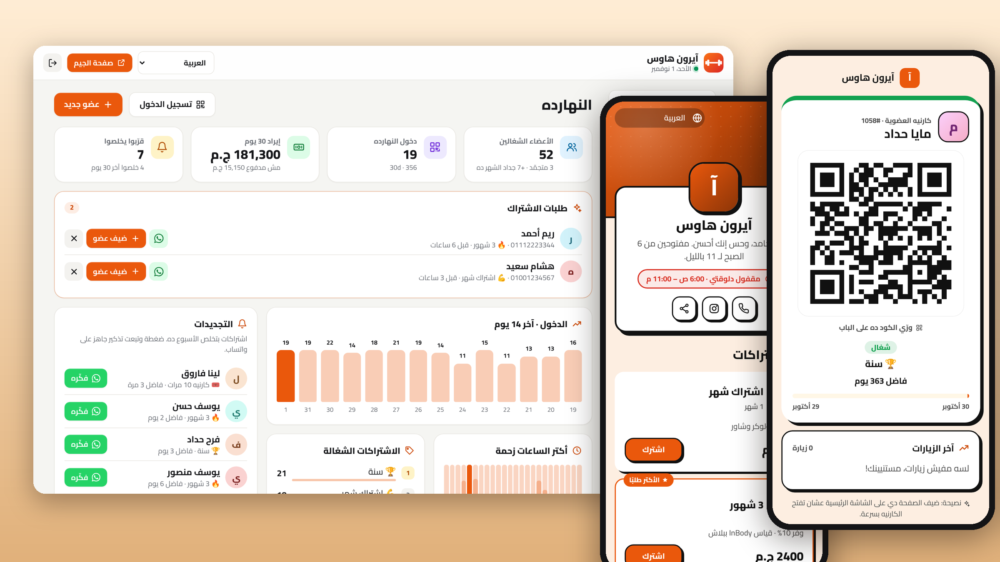

<div align="center">



# Nadi · نادي

**Self-hosted membership manager for gyms, studios, martial-arts clubs and sports academies.**
Members, plans, QR check-in at the door, freezes, payments and WhatsApp renewal reminders. No monthly fees. 8 languages.

[](https://www.hostinger.com/docker-hosting?compose_url=https://raw.githubusercontent.com/mashraf1997/nadi/main/docker-compose.yml&REFERRALCODE=YOUR_REFERRAL_CODE)

<sub>Part of a free suite of four apps for small businesses: <a href="https://mashraf1997.github.io/">mashraf1997.github.io</a></sub>

[English](README.md) · [العربية](README.ar.md)

</div>

---

## Why Nadi?

Most small gyms, yoga studios, boxing clubs and football academies run on a notebook, an Excel sheet or an old Windows program at the front desk. Nobody knows who has expired, members slip in on old plans, and renewals are chased by hand. Gym software fixes that for **$50–$200 a month**, usually without Arabic or WhatsApp.

Nadi runs on your own server, with your own domain:

1. **Deploy** with one click (HTTPS included).
2. **Pick your type**: gym, yoga & Pilates studio, boxing & martial arts, or sports academy. You start with ready-made plans and a class timetable.
3. **Add members and sell plans.** Every member gets a **membership card link with a QR code**. They show it at the door, or scan it on a tablet that checks them in automatically.
4. **Renew with one tap.** Nadi lists who ends this week and who lapsed, and opens WhatsApp with a ready-made reminder.



## Features

**At the door**
- 📱 **Digital membership card** for every member: QR code, plan, days or visits left, recent visits. No app to install, it's just a link they get on WhatsApp.
- 🚪 **Self check-in kiosk**: open a secret link on any tablet or old phone at the entrance. Members hold up their card and see a big green **Welcome, Omar!** or a red **Your membership has ended**, with a sound.
- 🎯 **Front-desk check-in**: scan with the laptop or phone camera, or search by name, phone or member number. Duplicate scans within 30 minutes don't count twice, and any check-in can be undone.
- 📷 Works on iPhone, Android and desktop: uses the built-in barcode scanner where available, with a fallback ([jsQR](https://github.com/cozmo/jsQR)) everywhere else.

**Memberships**
- 🏷️ **Plans** by months and/or days, or **visit packs** (e.g. "12 sessions within 2 months")
- 🔁 **Early renewals** start the day after the current plan ends, so nobody loses days
- ⏸️ **Freeze** for travel or injury. The end date moves back, and unfreezing early gives the unused days back.
- 💰 **Payments** in cash, card, transfer or mobile wallet, with **partial payments** and an unpaid balance per member
- ⏳ Optional **grace period**: let members in for a few days after their plan ends, with a warning
- 👤 Member profiles with photo, notes (injuries, goals), visit history, payments and plan history

**Growing the gym**
- 🔔 **Renewals due**: plans ending this week, each with one-tap WhatsApp reminders
- 💔 **Win them back**: members whose plans ended this month and weren't renewed
- 📊 **Today dashboard**: active members, check-ins, 30-day revenue with trend, unpaid balances, 14-day check-in chart, **busiest hours**, plan mix
- 🌐 **Public gym page**: plans with prices, a **class timetable**, opening hours and a **Join** button. Join requests arrive in the admin, by WhatsApp and on Telegram.
- 📲 **Telegram notifications** for new join requests
- 📄 **Excel exports** of members and payments, plus a full JSON backup and restore
- 🎨 4 themes, 5 Arabic-friendly fonts, any colour, logo and cover, with a live phone preview
- 🌍 **8 languages**: English, العربية (full RTL), Español, Português, Français, Türkçe, Bahasa Indonesia, हिन्दी

**For the server**
- 🔌 **Optional connections**: online payments (Paymob, Stripe), automatic WhatsApp messages, email, phone notifications, daily backups ([details](#connections-optional))
- Node.js + Express, **4 small dependencies**, no database to set up (atomic JSON files)
- Runs on the smallest VPS. Docker image for `amd64` and `arm64`, tested on Node 18–24.
- **Automatic HTTPS** with Caddy, **setup code** to protect a fresh install, **demo mode**
- **Agency mode**: one server hosts many gyms, each on its own domain ([details](#agency-mode-host-all-your-clients-on-one-server))

## Screenshots

| Today | Check-in |
|---|---|
|  |  |
| **Members** | **Member profile** |
|  |  |



<details><summary>Arabic (RTL)</summary>



</details>

## Deploy

### Option 1 — One click on a Hostinger VPS (recommended)

1. Click **Deploy on Hostinger** above. Docker Manager reads [`docker-compose.yml`](docker-compose.yml), which runs Nadi behind [Caddy](https://caddyserver.com).
2. **HTTPS:** point your domain's DNS **A record** at the VPS and set `DOMAIN=gym.example.com`. Caddy gets the certificate automatically. HTTPS is also what lets the camera work for check-in.
3. **Setup code:** open the `nadi` container's **logs** in Docker Manager and copy `Setup code: XXXX-XXXX`, or set your own with `SETUP_CODE`.
4. Open your domain, go to `/admin`, enter the code and finish the 1-minute setup.

### Option 2 — Hostinger Node.js web app

1. hPanel → **Websites → Add website → Node.js app → Import Git repository**, pick your fork.
2. Framework **Express**, Node **20+**, entry file `server.js`.
3. Environment variables: `SETUP_CODE` (any code you choose) and `DATA_DIR` (a folder **outside** the app folder, e.g. `/home/<user>/nadi-data`).
4. Deploy and open `/admin`.

### Option 3 — Docker anywhere

```bash
curl -O https://raw.githubusercontent.com/mashraf1997/nadi/main/docker-compose.yml
```

```bash
DOMAIN=gym.example.com docker compose up -d
```

```bash
docker compose logs nadi | grep "Setup code"
```

### Option 4 — Plain Node.js

```bash
git clone https://github.com/mashraf1997/nadi.git
cd nadi
npm install --omit=dev
npm start
```

## The door kiosk

1. In the admin, open **Check-in** (or **Share**) and copy the **kiosk link**. It contains a secret token, so treat it like a key.
2. Open it on a tablet or an old phone at the entrance and allow the camera. The screen stays awake.
3. Members open their card link (sent to them on WhatsApp when they join) and hold the QR up to the camera.

The kiosk only accepts card QR codes, never typed member numbers, and only shows the member's first name and status. If a tablet goes missing, press **Change kiosk link** and the old link stops working.

## Connections (optional)

Everything works without these. Turn on only what you need in **Admin → Connections**. Keys and passwords stay on your server: they are never sent to the browser and never included in exports or backups.

### Online payments: Paymob or Stripe

With a payment provider connected, members renew their plan from their member card when it is about to end (or has ended); the new period starts the day after the current one and the payment is recorded as **Online**.

- **Paymob** (Egypt, Saudi Arabia, UAE, Oman, Pakistan): paste your secret key, public key, HMAC secret and integration IDs from the Paymob dashboard, then paste the callback URL shown in the panel as the *Transaction processed callback*.
- **Stripe** (worldwide): paste your secret key (`sk_live_…` or `sk_test_…`). Optionally add a webhook to `https://your-domain/webhooks/stripe` for `checkout.session.completed` and paste its signing secret.
- Each payment is checked with the provider when the customer comes back, and again by the webhook if they close the page. The amount and currency are verified and a payment is counted only once. Use test keys and **Open a test payment** to try it.
- Your manual payment details and payment link still work when no provider is connected.

### Automatic WhatsApp messages (WhatsApp Cloud API)

Without this, the one-tap WhatsApp links keep working as before. With it, these messages go out on their own from your business number:

| Message | Sent when | Template name |
|---|---|---|
| Membership started / renewed | you sell a plan, or a member renews online | `nadi_subscribed` |
| Renewal reminder | 3 days before a plan ends, after 10:00, unless already renewed | `nadi_renewal` |

1. Create an app at [Meta for Developers](https://developers.facebook.com/) with the WhatsApp product, and copy the **phone number ID** and a **permanent access token** (system user).
2. WhatsApp only lets businesses start conversations with approved templates. Create each template with the exact text shown in the panel (copy button), wait for approval, then switch it on.
3. **Send test** sends Meta's `hello_world` template to check the connection. Meta bills business-initiated conversations according to its own pricing.

### Email (SMTP)

Use any mailbox, for example your Hostinger email (`smtp.hostinger.com`, port 465 with SSL/TLS, or 587). With email set up, you get alerts (join requests, online renewals) and the daily backup by email. Alerts and the daily backup copy can each be switched on or off.

### Notifications on this device

The admin can be installed on your phone's home screen like an app. Press **Turn on notifications** on each device that should get an instant notification for new activity, no Telegram needed (on iPhone, add the admin to the home screen first; iOS 16.4+). Telegram alerts still work too.

### Automatic daily backups

Every day the app saves a backup to `DATA_DIR/backups/` and keeps the last 14 days. Download any of them from the panel, or press **Back up now**. Turn on **Email me the daily backup** to keep a gzipped copy off the server. To restore, use **Settings → Backup → Restore backup**. If the app hits an error or a backup fails, you get an alert (at most once an hour).

### White-label (agency mode)

In the agency panel (`/hub` → Settings), set your agency name and website: every client page then says "powered by *your agency*" instead of Nadi, or you can hide the line completely. Client login screens show your name too.

## Agency mode: host all your clients on one server

Freelancers and agencies can run **one Nadi server for many gyms**. Each client gets their own fully separate Nadi (own admin, password, members and photos) at `client.yourdomain.com` or their own domain, with automatic HTTPS. You manage everyone from one panel at `/hub`: create clients in seconds, send them their setup link on WhatsApp, track monthly fees and who's overdue, suspend unpaid clients and reset forgotten passwords.

1. Point two DNS records at your server: `apps.example.com` and the wildcard `*.apps.example.com`.
2. Run [`examples/agency/docker-compose.yml`](examples/agency) with `BASE_DOMAIN=apps.example.com`.
3. Open `https://apps.example.com/hub` and enter the setup code from `docker compose logs nadi`.

Caddy only requests certificates for addresses the panel knows about, so nobody can make your server request certificates for other domains. To try it locally: `HUB_MODE=true npm start`, then open `http://localhost:3000/hub`.

### Multiple branches

Each branch runs its own copy of Nadi on its own subdomain. [`examples/branches/`](examples/branches) has a `docker-compose.yml` and `Caddyfile` for two branches behind automatic HTTPS.

## Configuration

| Variable | Default | Description |
|---|---|---|
| `PORT` | `3000` | HTTP port |
| `DATA_DIR` | `./data` (`/data` in Docker) | Settings, members, plans, payments, check-ins, photos |
| `SETUP_CODE` | random, printed in the logs | Required to create the admin account on a fresh install |
| `DOMAIN` | *(empty)* | **docker-compose only.** Your domain for automatic HTTPS |
| `TRUST_PROXY` | `loopback, linklocal, uniquelocal` | Express `trust proxy` setting |
| `DEMO_MODE` | `false` | Public demo that resets itself (see below) |
| `DEMO_PASSWORD` | `demo1234` | Admin password shown in the demo |
| `DEMO_RESET_MINUTES` | `60` | Demo reset interval |
| `DEMO_LANG` / `DEMO_TYPE` | `en` / `gym` | Demo language and type (`gym`, `studio`, `martial`, `academy`) |
| `HUB_MODE` | `false` | `true` turns the server into an agency hub for many gyms |
| `BASE_DOMAIN` | `localhost` | Agency mode: clients get `<name>.BASE_DOMAIN` |
| `HUB_DOMAIN` | *(empty)* | Agency mode: only show the panel on this host |

### Live demo

```bash
docker run -d -p 80:3000 -e DEMO_MODE=true ghcr.io/mashraf1997/nadi:latest
```

A gym with 64 members in every state (active, ending this week, frozen, lapsed, visit packs), a month of check-ins and payments, and two join requests. Visitors log in with the password shown on screen. Password changes and restores are disabled, and everything resets every hour.

### Telegram notifications

In **Settings → Instant notifications (Telegram)**, paste a bot token from [@BotFather](https://t.me/BotFather), press **Find my chat** and **Send test**. You'll get a message for every join request from your gym page. The token stays on your server and is left out of backups.

### Data & backups

```
data/
├── db.json         # settings, plans, classes, join requests
├── members.json    # members
├── subs.json       # plans sold (start, end, visits used, freezes)
├── payments.json   # payments
├── checkins.json   # every check-in, allowed or refused
└── uploads/        # photos
```

Copy the folder, or use **Settings → Backup** to download and restore everything as one file. **Members (Excel)** and **Payments (Excel)** export CSV files that open correctly in Excel in every language.

## Security

- A fresh install can only be claimed with the **setup code**.
- scrypt password hashing, signed `HttpOnly` / `SameSite=Strict` session cookies, CSRF header check, rate-limited login, setup, join and kiosk endpoints.
- Card links use random 96-bit tokens and are marked `noindex`. The kiosk link is a separate secret you can rotate.
- CSV exports neutralise spreadsheet formulas.

## Development

```bash
npm install
npm run dev
```

```bash
npm test
```

The membership rules (end dates, freezes, visit packs, grace periods, check-in decisions) live in [`src/members.js`](src/members.js) with their own tests. Translations are in [`locales/`](locales): adding a language means adding a file.

## License

[MIT](LICENSE)
